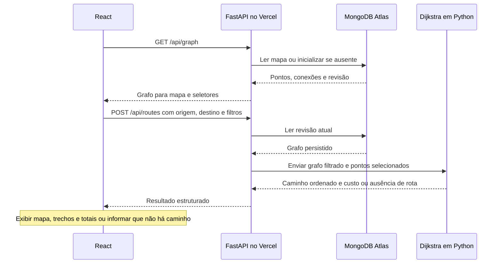
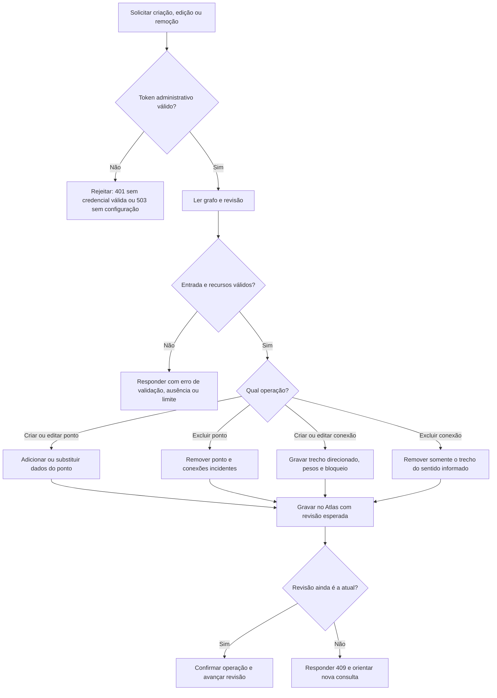

# Campus Viva — Visão e documentação técnica

**Projeto acadêmico de navegação em campus universitário** · **17 de novembro de 2026**
> Registro anterior à integração do planejador. Para o estado avaliado, consulte o Caderno Técnico e o README desta entrega.

Este documento segue a organização do documento de visão do OnTrack: posicionamento, partes interessadas, perfis, capacidades, restrições e prioridades. As regras de estoque e produção daquele projeto não se aplicam ao Campus Viva. A situação de cada recurso abaixo foi conferida nos pacotes do frontend React e do backend Python.

## 1. Visão do produto

O Campus Viva ajuda estudantes, visitantes e colaboradores a localizar espaços e planejar deslocamentos. Sua unidade de navegação é um grafo: cada local é um vértice e cada trecho representa uma ligação com sentido e custo definidos. A área de gestão permite manter esse mapa e bloquear trechos indisponíveis.

**Estado atual:** o React apresenta um protótipo navegável e responsivo. O FastAPI implementa consulta, edição e cálculo real reaproveitando o Dijkstra da Entrega 04. A montagem de produção prevista é React → API no Vercel → MongoDB Atlas. O React ainda não chama a API, e o deploy e a conexão remota com o Atlas não foram validados. Não há login, permissões por pessoa ou persistência de favoritos.

## 2. Partes interessadas e usuários

Os papéis abaixo são propostos para o campus; não representam pessoas cadastradas no código.

| Parte interessada | Interesse e responsabilidade | Critério de sucesso |
| --- | --- | --- |
| Comunidade acadêmica e visitantes | Encontrar entradas, salas, bibliotecas e serviços | Consultar um caminho com origem, destino e custo claros |
| Gestão acadêmica e infraestrutura | Manter nomes, conexões e interdições conforme a realidade do campus | Uma alteração validada aparece no mapa e afeta o próximo cálculo |
| Núcleo de acessibilidade | Validar quais trechos podem receber a indicação de acessível | Rotas acessíveis só usam trechos explicitamente verificados |
| Equipe de desenvolvimento e TI | Manter a API, publicação, credenciais e banco; investigar indisponibilidade | Implantar a aplicação e reproduzir os fluxos essenciais em homologação |
| Docente ou banca | Verificar o reaproveitamento do algoritmo e a demonstração integrada | A seleção feita na tela aciona o Dijkstra Python e exibe o resultado correspondente |

| Perfil | Ambiente e tarefas | Capacidade atual |
| --- | --- | --- |
| Visitante, estudante ou colaborador | Mobile e desktop: planejar rota, explorar locais, consultar acessibilidade e favoritos | Quatro áreas no React. Consulta e cálculo existem na API pública; a interface ainda mostra exemplos |
| Editor do mapa | Desktop: revisar e manter locais, conexões e bloqueios | Formulários ilustrativos. Mutações na API aceitam um token administrativo compartilhado; não há perfil Editor real |
| Administrador | Desktop: supervisionar dados, equipe e configurações | Tela ilustrativa. Não há cadastro de usuários, login, sessão nem distinção técnica entre Editor e Administrador |

A divisão por largura da tela é uma decisão de interface e não concede nem impede acesso à API.

## 3. Requisitos funcionais

| ID | Requisito e aceite | Situação |
| --- | --- | --- |
| RF01 | Visualizar o mapa e consultar locais. Um local deve aparecer com identificação e categoria; a busca e o filtro devem restringir os resultados. | React usa JSON local; API fornece o grafo por `GET /api/graph`. Integração pendente. |
| RF02 | Selecionar origem, destino e critério e solicitar o melhor caminho. A resposta deve refletir as escolhas. | API implementada em `POST /api/routes`; tela mostra um exemplo fixo. |
| RF03 | Apresentar caminho ordenado, trechos, distância e tempo quando disponível. Distinguir ausência de caminho de falha de serviço. | API retorna resultado estruturado; renderização dinâmica e estados de carregamento/erro pendentes. |
| RF04 | Criar, editar e remover locais. Ao remover um local, remover conexões de entrada e saída no mesmo salvamento. | API implementada; formulário React sem gravação. |
| RF05 | Criar, alterar ou remover uma conexão direcionada. Os pontos de origem e destino devem estar cadastrados para criar ou alterar o trecho. | API implementada; editor React demonstrativo. |
| RF06 | Bloquear ou liberar um trecho e refletir o estado no próximo cálculo. | API usa `blocked` na conexão; avisos do React são estáticos. |
| RF07 | Permitir a consulta de rota acessível, limitada a trechos marcados explicitamente como acessíveis. | API aceita `accessible: true`; preferências do React não são aplicadas. |
| RF08 | Consultar, adicionar e remover favoritos. | Tela com coleção fixa; sem API ou armazenamento por pessoa. |
| RF09 | Identificar usuários e aplicar permissões de consulta, edição e administração. | Perfis ilustrativos; backend protege escrita com Bearer, sem contas individuais. |
| RF10 | Manter o grafo entre execuções e proteger alterações concorrentes. | Repositório MongoDB implementado com controle de revisão; Atlas remoto pendente de validação. |

## 4. Requisitos não funcionais

| ID | Requisito | Evidência ou verificação |
| --- | --- | --- |
| RNF01 | Usabilidade e responsividade | Até 767 px, quatro abas de consulta; a partir de 768 px, incluir quatro telas de gestão. Codebase React/CSS. |
| RNF02 | Confidencialidade de credenciais | URI do MongoDB e token em variáveis do servidor; não incluir em `VITE_*`. Configurar origens CORS explícitas. Para edição no navegador, implementar autenticação individual ou um serviço intermediário autenticado. |
| RNF03 | Integridade de dados | Validar entradas, manter pontos e conexões na mesma revisão e responder `409` se uma gravação concorrente invalidar a versão lida pelo controller. |
| RNF04 | Recuperação de falhas | Storage indisponível retorna `503`. O frontend integrado deverá apresentar estado de erro e permitir tentar novamente. |
| RNF05 | Manutenibilidade e rastreabilidade | Separar controller, repositório e algoritmo; conservar a implementação Python da Entrega 04. Disponibilizar documentação da API em `/docs`. |
| RNF06 | Implantação reproduzível | Python 3.12, dependências declaradas, configuração do Vercel e exemplo de ambiente versionáveis sem segredos. Conferir API e Atlas após a publicação. |
| RNF07 | Capacidade e desempenho | Limites de 500 pontos e 5.000 conexões por mapa; cliente Mongo reutilizado no processo. Não foram definidos ou medidos tempos de resposta em produção. |
| RNF08 | Acessibilidade da interface | Preservar rótulos, foco visível e uso por teclado ao integrar o resultado real. Uma auditoria de acessibilidade ainda não foi realizada. |

## 5. Regras de negócio

| ID | Regra |
| --- | --- |
| RN01 | `A → B` não implica `B → A`. Para ida e volta, cadastrar os dois sentidos. |
| RN02 | Há uma conexão por par ordenado. Salvar o mesmo par atualiza a conexão; não cria uma paralela. |
| RN03 | Distância e tempo, quando informado, devem ser finitos e não negativos. A API limita cada peso a 10.000.000. |
| RN04 | A rota minimiza o peso selecionado: distância em metros ou tempo em minutos. Trecho sem tempo cadastrado não participa do critério tempo. |
| RN05 | Trechos bloqueados não participam do cálculo. No modo acessível, somente trechos com `accessible: true` entram; valor ausente ou nulo não confirma acessibilidade. |
| RN06 | Origem e destino devem existir. Se forem iguais, o caminho contém um ponto, sem trechos, com custo zero. Se não houver caminho, retornar `found: false`, listas vazias e custos nulos. |
| RN07 | Um local removido perde todas as conexões associadas, tanto de saída quanto de entrada. Para remover só um trecho, excluir a conexão daquele sentido. |
| RN08 | Mutações exigem token administrativo com pelo menos 32 caracteres configurados no servidor. Sem configuração, a escrita fica indisponível. |
| RN09 | A primeira consulta cria o mapa selecionado se ainda não existir. Os conjuntos `original` e `frontend` são documentos distintos; reiniciar a API não sobrescreve edições. |
| RN10 | Calcular uma rota não cria histórico persistente. A primeira consulta pode inicializar o grafo, mas o resultado de rota é calculado sob demanda. |

## 6. Arquitetura e fluxo de processos

### Fluxo de navegação previsto após a integração



O Vercel é o ambiente da API Python. O Atlas guarda o grafo; o navegador não acessa o banco diretamente. O controller adapta os IDs de texto para os códigos inteiros de `CampusMap`, monta as arestas utilizáveis para o critério e converte o resultado em objetos com nomes e coordenadas. A resposta leva a revisão usada no cálculo. Quando o React estiver integrado, pode recarregar o grafo se o resultado vier de uma revisão diferente daquela exibida no mapa.

### Fluxo administrativo de criação e gerenciamento

O fluxo abaixo já existe no lado da API. Ele pode ser exercitado por um cliente autorizado, como o Swagger local; o React ainda não executa mutações.



### Fluxo de implantação e verificação

1. Importar no Vercel a pasta do backend com `app.py`, `vercel.json`, `.python-version` e `requirements.txt`.
2. Configurar `MONGODB_URI`, `MONGODB_DB`, `CAMPUS_DATASET`, `CORS_ORIGINS` e, se for necessário operar edições, `ADMIN_TOKEN`. Autorizar no Atlas a conexão do ambiente onde a API executará.
3. Publicar a API. Conferir `GET /api/health` para disponibilidade do serviço e `GET /api/graph` para verificar leitura e inicialização no banco. Conferir um cálculo real em `/docs`.
4. Implementar as chamadas no React e configurá-lo com a URL da API. Para o mesmo mapa do protótipo, usar `CAMPUS_DATASET=frontend`.
5. Homologar: rota por distância e por tempo quando disponíveis, rota inexistente, alteração autorizada, conflito e persistência após reinício. Para o mapa original, `1 → 3` por distância deve retornar `1 → 2 → 3`, totalizando 250 m; `1 → 4` não tem caminho.

## 7. Modelo de dados

| Entidade | Campos e vínculos | Armazenamento |
| --- | --- | --- |
| Grafo | `_id`: conjunto selecionado; `revision`: versão; contém zero ou mais pontos e conexões. | Documento raiz da coleção `graphs` dentro do banco configurado. |
| Ponto | `id`, `name`, `category`, `x`, `y`. Um ponto pode ter várias conexões de entrada ou saída. | Objeto embutido em `nodes`. |
| Conexão | `id`, `from`, `to`, `distance`, `time`, `accessible`, `blocked`. `from` e `to` apontam para IDs de pontos do mesmo grafo. | Objeto embutido em `edges`. |
| Resultado de rota | `found`, `criterion`, `path`, `segments`, `cost`, `distance`, `time`, `revision`. | Resposta calculada; não é documento do Atlas. |
| Interdição | Indicação em `blocked` na conexão. A API não guarda motivo, vigência ou histórico. | Campo da conexão; avisos do React são exemplos. |
| Usuário e favorito | Perfis e coleção de exemplo na interface. | Não possuem coleções nem endpoints nesta versão. |

Os mapas iniciais têm tamanhos diferentes: o `original` tem quatro pontos e quatro conexões com distância; o `frontend` tem 24 pontos e 71 conexões, com os mesmos IDs e coordenadas da interface. As coordenadas são esquemáticas.

## 8. Guia do código e contrato HTTP

| Arquivo | Responsabilidade |
| --- | --- |
| Frontend `src/main.jsx` | Componentes, navegação por largura, telas, SVG, busca local, modais e exemplo fixo de trajeto. |
| Frontend `src/styles.css` e `src/campus.json` | Apresentação responsiva e dados demonstrativos. |
| Backend `app.py` | Inicializa FastAPI, declara CORS, desabilita cache das respostas da API e traduz falhas de armazenamento em `503`. |
| Backend `campus/controllers.py` | Modelos de entrada, dependência de autorização, cálculo, operações administrativas e tratamento de conflitos. |
| Backend `campus/campus_navigation.py` | Classe original `CampusMap`, grafo direcionado em lista de adjacência e Dijkstra com fila de prioridade. |
| Backend `campus/repository.py` e `data/frontend.json` | Reuso do cliente PyMongo, carga inicial e atualização atômica por revisão. |
| Backend `tests/test_api.py` | Testes HTTP com repositório em memória. |

| Endpoint | Acesso | Comportamento |
| --- | --- | --- |
| `GET /api/health` | Público | Confirma execução da aplicação, sem consultar o banco. |
| `GET /api/graph` | Público | Retorna `revision`, `nodes` e `edges`. |
| `POST /api/routes` | Público | Recebe `origin`, `destination` e opcionalmente `criterion` e `accessible`. Sem caminho: `200` com `found: false`. |
| `POST /api/points` | Bearer | Cria ponto e retorna `201`. |
| `PUT /api/points/{point_id}` | Bearer | Substitui dados do ponto; mantém seu ID. |
| `DELETE /api/points/{point_id}` | Bearer | Remove ponto e ligações associadas; retorna `204`. |
| `PUT /api/connections/{origin}/{destination}` | Bearer | Insere ou substitui a ligação direcionada. Enviar o objeto completo para preservar os demais campos. |
| `DELETE /api/connections/{origin}/{destination}` | Bearer | Remove a ligação direcionada; retorna `204`. |

Exemplo para o mapa original:

```json
{"origin": "1", "destination": "3", "criterion": "distance", "accessible": false}
```

## 9. Prioridades e critérios de entrega

| Prioridade | Próximo trabalho | Critério de aceite |
| --- | --- | --- |
| P0 | Integrar rota e mapa do React com a API Python | Alterar os parâmetros na tela muda o resultado conforme o grafo; o mapa e os totais correspondem à resposta. |
| P0 | Homologar Vercel e Atlas | Serviço acessível, grafo lido no Atlas e edição autorizada preservada após reinício. |
| P1 | Conectar controles de edição, interdição e acessibilidade | Operações autorizadas atualizam o grafo; o cálculo ignora trechos bloqueados e respeita o filtro acessível. |
| P1 | Implementar autenticação e perfis para edição no navegador | Visitante não consegue gravar; editor autorizado opera apenas o escopo concedido. |
| P2 | Persistir favoritos e definir política de auditoria | Favoritos são privados por conta e voltam após nova sessão; alterações do mapa são rastreáveis conforme política definida. |

**Verificação realizada:** quatro testes HTTP com repositório em memória passaram, cobrindo rota original, sentido das conexões, ausência de caminho, bloqueio e acessibilidade, proteção e validação de edições, remoção de ligações e conflito de revisão. Não houve teste de persistência no Atlas real nem deploy do backend no Vercel.

**Fontes consultadas:** documento de visão `OnTrack.pdf` (referência de estrutura, especialmente as seções 3–10); código nos pacotes `CampusViva_React_Interface.zip` e `CampusViva_Backend.zip`. Os diagramas são editáveis em Mermaid.
